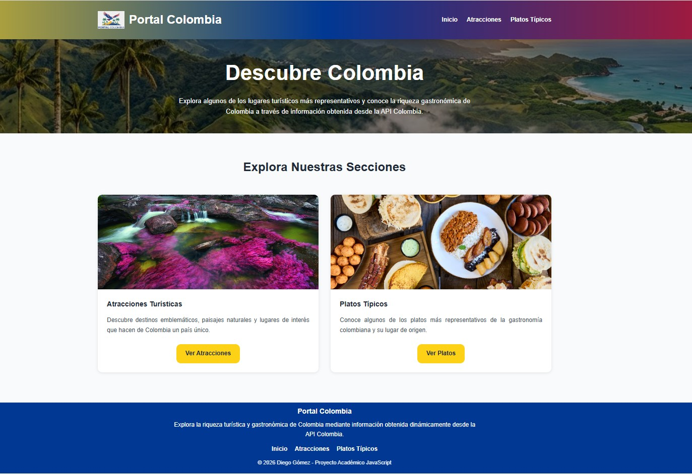
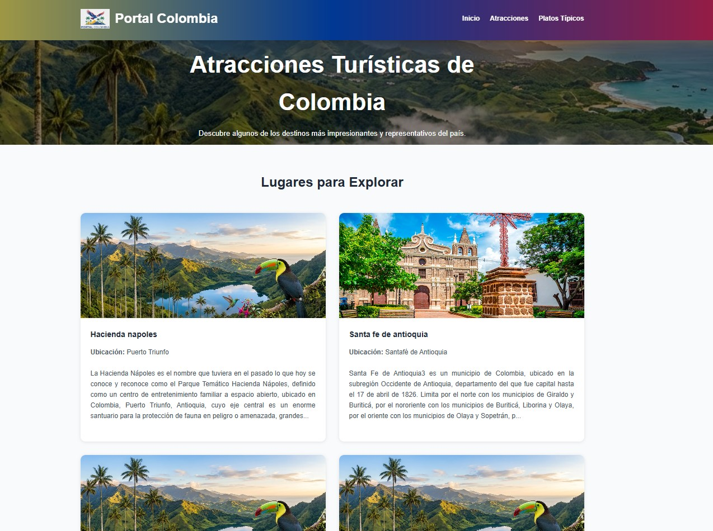
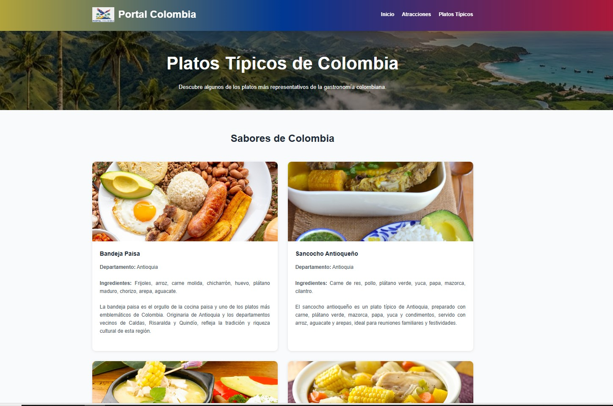

# 🇨🇴 Portal Colombia

Proyecto desarrollado por **Diego Gómez** como parte del módulo de JavaScript. La aplicación consume información de la API pública de Colombia y muestra dinámicamente datos turísticos y gastronómicos del país mediante HTML, CSS y JavaScript.

---

## 📖 Descripción

Portal Colombia es un sitio web informativo que permite explorar algunos de los principales atractivos turísticos y platos típicos de Colombia.

La aplicación obtiene información en tiempo real desde la API Colombia utilizando peticiones `fetch()`, procesa los datos recibidos y los muestra dinámicamente en el DOM mediante tarjetas informativas. Además, incorpora imágenes predeterminadas para garantizar una correcta visualización cuando alguna imagen proporcionada por la API no está disponible o presenta errores de carga.

El proyecto fue desarrollado siguiendo una arquitectura organizada, separando el código HTML, CSS y JavaScript en archivos independientes para facilitar su mantenimiento y escalabilidad.

---

## 🌐 Repositorio

Puedes consultar el código fuente completo del proyecto en el siguiente repositorio:

[Repositorio Portal Colombia](https://github.com/Diego-Gomez-Vi/diego-gomez-api-colombia)

---

## ✨ Funcionalidades

### 🏞️ Atracciones Turísticas

- Consulta de atracciones turísticas de Colombia mediante la API.
- Visualización de nombre, ciudad y descripción.
- Presentación de los primeros 20 registros obtenidos.
- Carga dinámica de tarjetas en el DOM.
- Uso de imágenes proporcionadas por la API.
- Implementación de imágenes de respaldo cuando alguna imagen no está disponible.

### 🍲 Platos Típicos

- Consulta de platos típicos colombianos mediante la API.
- Visualización de nombre, departamento, ingredientes y descripción.
- Presentación de los primeros 20 registros obtenidos.
- Carga dinámica de tarjetas en el DOM.
- Implementación de imágenes de respaldo cuando alguna imagen no está disponible.

### ⚙️ Características Generales

- Navegación mediante hipervínculos.
- Manipulación dinámica del DOM con JavaScript.
- Consumo de API con `fetch()`.
- Programación asíncrona con `async/await`.
- Manejo de errores mediante `try...catch`.
- Mensajes de carga durante las peticiones.
- Diseño responsive para dispositivos móviles, tabletas y escritorio.
- Interfaz inspirada en los colores de la bandera de Colombia.
- Uso de imágenes predeterminadas cuando alguna imagen proporcionada por la API no está disponible o presenta errores de carga.

---

## 🛠️ Tecnologías Utilizadas

- HTML5
- CSS3
- JavaScript (ES6)
- Fetch API
- API Colombia

---

## 🔗 Endpoints Utilizados

### Atracciones Turísticas

```text
https://api-colombia.com/api/v1/TouristicAttraction
```

### Platos Típicos

```text
https://api-colombia.com/api/v1/TypicalDish
```

---

## 📂 Estructura del Proyecto

```text
diego-gomez-api-colombia
│
├── css
│   ├── components.css
│   ├── layout.css
│   └── main.css
│
├── img
│   ├── atraccion-default.jpg
│   ├── atracciones.jpg
│   ├── hero-colombia.jpg
│   ├── logo-colombia.jpg
│   ├── plato-default.jpg
│   ├── platos.jpg
│   └── readme
│       ├── inicio.jpg
│       ├── atracciones.jpg
│       └── platos.jpg
│
├── js
│   ├── atracciones.js
│   └── platos.js
│
├── atracciones.html
├── index.html
└── platos.html
```

---

## 🚀 Instrucciones de Uso

1. Clona este repositorio:

```bash
git clone https://github.com/Diego-Gomez-Vi/diego-gomez-api-colombia.git
```

2. Ingresa a la carpeta del proyecto.

3. Abre el archivo `index.html` en tu navegador.

4. Navega entre las distintas secciones:

   - Inicio
   - Atracciones Turísticas
   - Platos Típicos

---

## 📸 Capturas de Pantalla

### 🏠 Página de Inicio



---

### 🏞️ Atracciones Turísticas



---

### 🍲 Platos Típicos



---

## 👨‍💻 Autor

**Diego Gómez**

Proyecto académico desarrollado para el módulo de JavaScript utilizando la API pública de Colombia.

---

## 📄 Licencia

Este proyecto fue desarrollado con fines educativos y académicos.